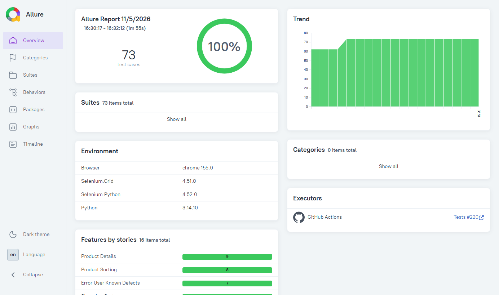

# UAT Automation Framework

[](https://github.com/brunoccalmeida/uat-automation-framework/actions/workflows/tests.yml)
[](https://github.com/brunoccalmeida/uat-automation-framework/actions/workflows/security.yml)
[](https://codecov.io/gh/brunoccalmeida/uat-automation-framework)
[](https://www.python.org/downloads/)
[](LICENSE)

**[English]** | **[Português (Brasil)](README.pt-BR.md)** | **[Español](README.es.md)**

Comprehensive UAT automation framework using Python, Behave (BDD), and Selenium for testing the **Sauce Demo** e-commerce application.

## ⚡ At a Glance

- **Tests:** 760 unit · 96 integration · 73 E2E scenarios, built with double-loop TDD (Behave scenarios drive pytest unit tests)
- **Real browsers:** integration and smoke suites run on Chrome and Firefox in CI, inside docker-selenium containers
- **Quality gates:** `master` only accepts a PR with green CI and a clean `pip-audit`; every GitHub Action is pinned to a commit SHA
- **Live report:** Allure, republished on every merge to `master`: 📊 **[View Latest Test Report](https://brunoccalmeida.github.io/uat-automation-framework/)**
- **AI-assisted, same gates:** built with an AI coding agent that gets no shortcut past CI, tests-first and review: [How This Project Is Built](#-how-this-project-is-built)

[](https://brunoccalmeida.github.io/uat-automation-framework/)

## 📑 Table of Contents

- [Purpose](#-purpose)
- [Architecture](#️-architecture)
- [Getting Started](#-getting-started)
- [Testing Strategy](#-testing-strategy)
- [Technology Stack](#️-technology-stack)
- [CI/CD](#-cicd)
- [How This Project Is Built](#-how-this-project-is-built)
- [Project History](#-project-history)
- [Contributing](#-contributing)
- [License](#-license)

## 🎯 Purpose

This framework demonstrates professional UAT automation practices for web applications, featuring:
- **Target Application**: [Sauce Demo](https://www.saucedemo.com) - stable e-commerce demo by Sauce Labs
- Behavior-Driven Development (BDD) with Behave
- Page Object Model design pattern
- Comprehensive reporting with Allure
- Pre-configured test users (no credential management needed)

### Test Users

Sauce Demo provides pre-configured test users (password: `secret_sauce` for all):

- `standard_user` - Normal user, no issues
- `locked_out_user` - User has been locked out
- `problem_user` - User experiences visual glitches
- `performance_glitch_user` - User has performance issues
- `error_user` - User encounters errors
- `visual_user` - User has visual testing variations

**Security**: No credential storage needed - users are provided by the demo application.

## 🏗️ Architecture

```
uat-automation-framework/
├── core/              # Framework core (config, drivers, utilities)
├── pages/             # Page Object Models
├── features/          # BDD feature files and step definitions
├── tests/             # Unit tests for framework components
└── reports/           # Test execution reports (gitignored)
```

### Design Paradigm: Pragmatic Hybrid Approach

This framework uses a **hybrid OOP/Functional programming approach**, choosing the right paradigm for each component:

**Object-Oriented Programming (60-70%)**
- **Page Objects**: Encapsulate page state and interactions (natural fit for UI automation)
- **Driver Manager**: Manages WebDriver lifecycle and state
- **Base Classes**: Shared functionality through inheritance where appropriate

**Functional Programming (30-40%)**
- **Utilities & Helpers**: Pure functions for data transformation and generation
- **Configuration Loading**: Stateless operations
- **Step Definitions**: Behave steps are naturally functional

**Rationale:**
- **Pragmatism over purity**: Use OOP where Selenium/Page Object patterns naturally fit
- **Testability**: Pure functions for business logic make unit testing straightforward
- **Industry standards**: Page Object Model is expected in professional test automation
- **Maintainability**: Familiar patterns reduce cognitive load for collaborators
- **Zen of Python**: "Practicality beats purity" - choose what works best for each case

## 🚀 Getting Started

### Prerequisites

- Python 3.14+
- Poetry (dependency management)
- Chrome or Firefox browser (drivers managed automatically by Selenium Manager)
- Docker (optional): runs the tests in the same browser build as CI (see [Same browser as CI](#same-browser-as-ci-selenium-grid-in-docker))

### Installation

```bash
# Install dependencies
poetry install

# Install pre-commit hooks (one-time setup)
poetry run pre-commit install
```


**Pre-commit Hooks & Lint Configuration:**
The hooks in `.pre-commit-config.yaml` are the lint gate: the CI `lint` job runs the same hooks (`pre-commit run --all-files`), with no excluded folders and no ignored failures (`tests/test_lint_gate.py`). Linters run through Poetry, so their versions come from `poetry.lock`.

- ✅ **Black**: Code formatting (88 columns)
- ✅ **Ruff**: Style and error rules (flake8's `E`, `W`, `F`), import order (`I`) and the Pylint rules it implements (`PL`), configured in `[tool.ruff.lint]` (`pyproject.toml`)
- ✅ **Pylint**: Checks Ruff lacks, such as inference and duplicate code (`[tool.pylint.*]` in `pyproject.toml`; each disabled check has its reason next to it, and no check runs in both linters)
- ✅ **Pyright**: Static type checking (`[tool.pyright]` in `pyproject.toml`; the editor runs the same checker)
- ✅ **Security**: Detect private keys, merge conflicts
- ✅ **Quality**: Trailing whitespace, YAML validation, README metrics and translations

Hooks run automatically on `git commit`. To run all hooks manually: `pre-commit run --all-files`

### Running Tests

**BDD/E2E Tests (Behave):**
```bash
# Run all E2E tests (headless by default)
poetry run behave

# Run specific feature
poetry run behave features/smoke.feature
poetry run behave features/login.feature

# Run with visible browser (useful for debugging)
poetry run behave -Dheadless=false

# Run with Firefox (Chrome is default)
poetry run behave -Dbrowser=firefox

# Run Firefox in visible mode
poetry run behave -Dbrowser=firefox -Dheadless=false

# Run in headless mode via environment variable (useful for CI/CD)
$env:HEADLESS="true"; poetry run behave  # PowerShell
export HEADLESS=true && poetry run behave  # Bash

# Override browser via environment variable
$env:BROWSER="firefox"; poetry run behave  # PowerShell
export BROWSER=firefox && poetry run behave  # Bash

# Run with Allure reporting
poetry run behave -f allure_behave.formatter:AllureFormatter -o reports/allure-results

# Generate and view Allure report
allure serve reports/allure-results
```

**Running Tests by Tags:**

The framework uses a hierarchical tag system for precise test filtering:

```bash
# Run by test layer
poetry run behave --tags=@e2e              # All E2E tests (default)

# Run by test type
poetry run behave --tags=@smoke            # Critical smoke tests only
poetry run behave --tags=@functional       # Happy path scenarios
poetry run behave --tags=@negative         # Negative/edge cases
poetry run behave --tags=@user_journey     # Complete user flows

# Run by domain/feature
poetry run behave --tags=@login            # All login tests (functional + negative)
poetry run behave --tags=@cart             # All cart tests
poetry run behave --tags=@checkout         # All checkout tests
poetry run behave --tags=@sorting          # All sorting tests
poetry run behave --tags=@product_details  # All product details tests

# Run by priority/special
poetry run behave --tags=@critical         # Critical user journeys
poetry run behave --tags=@edgecase         # Known bugs/edge cases
poetry run behave --tags=@problem_user     # Problem user scenarios
poetry run behave --tags=@error_user       # Error user known defects

# Combine tags (AND logic)
poetry run behave --tags=@cart --tags=@negative    # Cart negative tests only
poetry run behave --tags=@functional --tags=@cart  # Cart functional tests only

# Exclude tags (NOT logic)
poetry run behave --tags=~@edgecase        # All except edge cases
poetry run behave --tags=@e2e --tags=~@smoke  # E2E excluding smoke
```

**Tag Hierarchy:**
- **Layer**: `@e2e` (all features use this)
- **Type**: `@functional` | `@negative` | `@user_journey` | `@smoke` | `@edgecase`
- **Domain**: `@login` | `@cart` | `@checkout` | `@sorting` | `@product_details`
- **Priority**: `@critical` | `@problem_user` | `@error_user`

**Cross-Browser Testing:**

The framework supports Chrome and Firefox browsers. Use `-D` flags to override default configuration:

```bash
# Run smoke tests with Firefox (headless)
poetry run behave --tags=@smoke -Dbrowser=firefox -Dheadless=true

# Run smoke tests with Firefox (visible browser)
poetry run behave --tags=@smoke -Dbrowser=firefox -Dheadless=false

# Run all tests with Chrome (default)
poetry run behave -Dbrowser=chrome

# Override multiple config values
poetry run behave -Dbrowser=firefox -Dheadless=false -Dtimeout=15
```

**Supported browsers:**
- `chrome` (default) - Google Chrome with ChromeDriver
- `firefox` - Mozilla Firefox with GeckoDriver

**Note**: Selenium Manager automatically downloads and manages browser drivers - no manual installation required.


**Unit Tests (Pytest):**
```bash
# Run all unit tests (parallel execution)
poetry run pytest tests/ -n auto -v

# Run with coverage report (parallel)
poetry run pytest tests/ -n auto --cov=core --cov=pages --cov-report=term-missing

# Run specific test module
poetry run pytest tests/test_login_page.py -v

# Run sequentially (for debugging)
poetry run pytest tests/ -n 0 -v

# Run all tests (unit + integration + E2E)
poetry run pytest tests/ -n auto && poetry run pytest tests/integration/ -n auto && poetry run behave
```

**Integration Tests (Pytest + Real Browser):**
```bash
# Run all integration tests (parallel execution)
poetry run pytest tests/integration/ -n auto -v

# Run specific integration test
poetry run pytest tests/integration/test_login_page_integration.py -v

# Run in headless mode (parallel)
$env:HEADLESS="true"; poetry run pytest tests/integration/ -n auto -v  # PowerShell
export HEADLESS=true && poetry run pytest tests/integration/ -n auto -v  # Bash
```

**Parallel Execution:**

This framework supports parallel test execution using `pytest-xdist`:
- **Performance**: 88% faster (188 tests in ~37s vs ~305s)
- **Safety**: All tests are independent (function-scoped fixtures)
- **Automatic**: Use `-n auto` to detect CPU cores automatically
- **Debugging**: Use `-n 0` to disable parallelization

See [docs/PARALLEL_TESTING.md](docs/PARALLEL_TESTING.md) for detailed documentation.

**Headless Mode Configuration:**

The framework runs in **headless mode by default** (best practice: faster, less resources, consistent with CI/CD).

Configuration priority:
1. **CLI Parameter** (highest): `-Dheadless=true/false`
2. **Environment Variable**: `HEADLESS=true/false`
3. **Config File** (lowest): `config.yaml` (default: `true`)

Use `-Dheadless=false` for debugging with visible browser.

See [CONFIGURATION.md](CONFIGURATION.md) for detailed configuration options.

### Same browser as CI (Selenium Grid in Docker)

CI runs every browser test against the Selenium Grid defined in [compose.yaml](compose.yaml) (official docker-selenium images, pinned by tag and digest). Running locally against the same container gives the same browser build as CI (12-factor dev/prod parity), whatever your operating system:

```bash
# Start the Grid; --wait returns once the health check passes (Grid ready)
SE_NODE_MAX_SESSIONS=$(nproc) docker compose up --wait chrome    # bash
$env:SE_NODE_MAX_SESSIONS=$env:NUMBER_OF_PROCESSORS; docker compose up --wait chrome  # PowerShell

# Point the tests at it (CLI -Dremote_url=... also works for Behave)
export SELENIUM_REMOTE_URL=http://localhost:4444          # bash
$env:SELENIUM_REMOTE_URL="http://localhost:4444"          # PowerShell
poetry run pytest tests/integration/ -n auto
poetry run behave

# Firefox Grid listens on port 4445 (-Dremote_url beats the env variable)
docker compose up --wait firefox
poetry run behave -Dbrowser=firefox -Dremote_url=http://localhost:4445

docker compose down
```

`SE_NODE_MAX_SESSIONS` gives the Grid one session per CPU, matching the workers of `pytest -n auto` (the image default is 1). Without `SELENIUM_REMOTE_URL`, tests use a local browser.

## 🔄 CI/CD

The project uses **GitHub Actions** for continuous integration:

- ✅ **Automated testing** on every push and pull request
- ✅ **Python 3.14** latest stable version
- ✅ **Headless browser** execution in CI environment
- ✅ **Browser in docker-selenium**: browser jobs start the Selenium Grid from `compose.yaml`, the same pinned image as local runs
- ✅ **Cross-browser integration**: Page Object integration tests run on Chrome and Firefox, in parallel jobs
- ✅ **Code quality** checks (Black, Ruff, Pylint, Pyright)
- ✅ **Test artifacts** uploaded for review
- ✅ **Allure reports** published to GitHub Pages with history
- ✅ **Vulnerability audit** with `pip-audit` (PyPI/OSV) on every pull request and daily, as a second source next to Dependabot (GitHub Advisory Database)
- ✅ **Secret scanning** of the whole git history with `gitleaks`, and a **workflow audit** with `zizmor` (template injection, excessive permissions, actions not pinned by SHA), both on every pull request

**View Test Reports:** [https://brunoccalmeida.github.io/uat-automation-framework/](https://brunoccalmeida.github.io/uat-automation-framework/)

The reports include:
- Test execution trends and history (last 20 runs)
- Detailed test results with screenshots on failure
- Duration metrics and performance tracking
- Categorization by features and scenarios
- Environment and executor: browser, Selenium Grid, Python and Selenium versions, with a link to the CI run

See [.github/workflows/tests.yml](.github/workflows/tests.yml) and [.github/workflows/security.yml](.github/workflows/security.yml) for pipeline configuration.

**Auditing dependencies locally** (same command and locked version as CI):

```bash
poetry sync --no-root            # make the environment match poetry.lock exactly
poetry run pip-audit --strict    # fails on any known vulnerability or unauditable package
```

Any known vulnerability fails the `pip-audit` check. To accept one, add `--ignore-vuln <ID>` in `security.yml` with the justification and the issue that tracks its removal.

## 🤖 How This Project Is Built

AI-assisted, behind the same gates as any other change. The work is done with an AI coding agent (Claude Code; GitHub Copilot reads the same rules), and its commits carry a Claude co-author trailer (`Co-Authored-By`). The agent gets no shortcut:

- **Same CI gates:** `master` accepts only a PR with `ci-passed` and `pip-audit` green on its head commit; the ruleset has no bypass, not even for the owner.
- **Tests first:** every test is seen failing before the code that makes it pass; when that was not observed, a mutation (undo the fix, watch the test fail) confirms it.
- **Independent review:** before each PR, a read-only reviewer agent checks the diff against its GitHub issue.
- **A human merges:** the agent opens the PR; only the owner triggers the merge, because a merge to `master` publishes the report.
- **Rules as code:** the agent rules live in the repository ([.github/copilot-instructions.md](.github/copilot-instructions.md)), and a rule without exceptions becomes a test (for example `tests/test_agent_rules.py`), not a reminder.

Working notes (session handoff, token-spend measurements; in Portuguese): [docs/ai-workflow/](docs/ai-workflow/).

## 🛠️ Technology Stack

- **Python 3.14**: Core language
- **Selenium 4**: Browser automation
- **Behave**: BDD/E2E testing framework
- **Pytest**: Unit testing framework
- **Allure**: Test reporting with history and trends
- **Poetry**: Dependency management
- **GitHub Actions**: CI/CD pipeline
- **GitHub Pages**: Live test report hosting

## 🧪 Testing Strategy

This framework implements the complete **Testing Pyramid** architecture with three distinct layers:

```
        E2E Tests (BDD)           ← Slow, Full User Flows
      /-------------------\
     / Integration Tests   \      ← Medium, Page+Browser
    /-----------------------\
   /      Unit Tests         \    ← Fast, Component Logic
  /---------------------------\
```

**Layer Distribution:**
- **Unit Tests**: 760 tests (framework components, 100% Page Objects coverage, CI guardrails)
- **Integration Tests**: 96 tests (Page Objects + real browser, including navigation synchronization)
- **E2E Tests**: 73 scenarios, 463 steps (complete user journeys)
- **Total**: 856 unit/integration tests + 73 E2E scenarios

**When to Use Each Layer:**
| Test Type | Purpose | Speed | Browser | Example |
|-----------|---------|-------|---------|---------|
| **Unit** | Component logic | Fast | Mocked | "Does `login()` call correct methods?" |
| **Integration** | Page + real DOM | Medium | Real | "Do login fields exist and work?" |
| **E2E** | Full user flows | Slow | Real | "Can user complete login→shop→checkout?" |

### BDD/E2E Tests (Behave)

| Feature | Source | Scenarios | Steps | Status |
|---------|--------|-----------|-------|--------|
| **Smoke Tests** | `features/smoke.feature` | 4 | 14 | ✅ Complete |
| **User Login** | `features/login.feature`, `features/login_negative.feature` | 9 | 42 | ✅ Complete |
| **Shopping Cart** | `features/cart.feature`, `features/cart_negative.feature` | 11 | 65 | ✅ Complete |
| **Checkout** | `features/checkout.feature`, `features/checkout_negative.feature` | 12 | 95 | ✅ Complete |
| **Product Sorting** | `features/product_sorting.feature`, `features/product_sorting_negative.feature`, `features/product_sorting_problem_user.feature` | 14 | 92 | ✅ Complete |
| **User Journey** | `features/user_journey_purchase.feature`, `features/user_journey_variations.feature`, `features/problem_user_journey.feature` | 5 | 78 | ✅ Complete |
| **Error User (known defects)** | `features/error_user.feature` | 7 | 35 | ✅ Complete |
| **Product Details (incl. known defects)** | `features/product_details.feature`, `features/product_details_known_defects.feature` | 11 | 42 | ✅ Complete |
| **TOTAL** | | **73** | **463** | **100%** |

### Unit Tests (Pytest)

| Module | Source | Tests | Coverage | Status |
|--------|--------|-------|----------|--------|
| **BasePage** | `tests/test_base_page.py` | 33 | 100% | ✅ Complete |
| **LoginPage** | `tests/test_login_page.py` | 16 | 100% | ✅ Complete |
| **CartPage** | `tests/test_cart_page.py` | 13 | 100% | ✅ Complete |
| **InventoryPage** | `tests/test_inventory_page.py` | 26 | 100% | ✅ Complete |
| **HeaderComponent** | `tests/test_header_component.py` | 20 | 100% | ✅ Complete |
| **ProductDetailsPage** | `tests/test_product_details_page.py` | 15 | 100% | ✅ Complete |
| **CheckoutStepOnePage** | `tests/test_checkout_step_one_page.py` | 15 | 100% | ✅ Complete |
| **CheckoutStepTwoPage** | `tests/test_checkout_step_two_page.py` | 16 | 100% | ✅ Complete |
| **CheckoutCompletePage** | `tests/test_checkout_complete_page.py` | 12 | 100% | ✅ Complete |
| **Config** | `tests/test_config.py` | 2 | 94% | ✅ Complete |
| **ConfigResolver** | `tests/test_config_resolver.py` | 48 | 100% | ✅ Complete |
| **DriverManager** | `tests/test_driver_manager.py` | 23 | 100% | ✅ Complete |
| **Browser test setup (BROWSER, HEADLESS, Grid)** | `tests/test_driver_setup.py` | 3 | N/A | ✅ Complete |
| **Step definitions (OR logic, configured password, local page objects)** | `tests/test_login_steps.py`, `tests/test_smoke_steps.py`, `tests/test_step_page_objects.py` | 20 | N/A | ✅ Complete |
| **Behave hooks (failure screenshot and URL in Allure)** | `tests/test_environment.py` | 9 | N/A | ✅ Complete |
| **Smoke Tests** | `tests/test_smoke.py` | 4 | N/A | ✅ Complete |
| **Workflow version comments (CI)** | `tests/test_workflow_version_comments.py` | 32 | N/A | ✅ Complete |
| **Security gates: gitleaks and zizmor (CI)** | `tests/test_security_gates_ci.py` | 10 | N/A | ✅ Complete |
| **Workflow hardening (CI)** | `tests/test_workflow_hardening.py` | 25 | N/A | ✅ Complete |
| **CI gate (required check)** | `tests/test_ci_gate.py` | 16 | N/A | ✅ Complete |
| **Selenium Grid in Docker (CI + compose)** | `tests/test_selenium_grid_ci.py` | 19 | N/A | ✅ Complete |
| **Codecov upload (CI)** | `tests/test_codecov_upload.py` | 6 | N/A | ✅ Complete |
| **Allure environment and executor (CI)** | `tests/test_allure_metadata.py` | 8 | N/A | ✅ Complete |
| **Integration failure screenshots and page source (CI)** | `tests/test_failure_artifacts.py` | 10 | N/A | ✅ Complete |
| **Agent rules (size, sync, skills, reviewer subagent, editor diagnostics, code intelligence)** | `tests/test_agent_rules.py` | 45 | N/A | ✅ Complete |
| **Doc links (every referenced path exists)** | `tests/test_doc_links.py` | 107 | N/A | ✅ Complete |
| **Agent test-output hook** | `tests/test_filter_test_output.py` | 21 | N/A | ✅ Complete |
| **Agent guardrails (deny rules)** | `tests/test_agent_guardrails.py` | 61 | N/A | ✅ Complete |
| **Merge when green (`/ship-pr`: required checks from the ruleset, allowlist)** | `tests/test_merge_when_green.py` | 24 | N/A | ✅ Complete |
| **Lint gate (pre-commit + CI + editor import order, ruff replaces flake8, no rule in two linters)** | `tests/test_lint_gate.py` | 25 | N/A | ✅ Complete |
| **README metrics (per-row sync from the Source column, translations)** | `tests/test_validate_readme_metrics.py` | 51 | N/A | ✅ Complete |
| **Text encoding gate (pre-commit, `.gitattributes`)** | `tests/test_check_text_encoding.py` | 12 | N/A | ✅ Complete |
| **Venv cache key (CI, exact Python version)** | `tests/test_venv_cache_key.py` | 4 | N/A | ✅ Complete |
| **Python version source (CI, `.python-version`)** | `tests/test_python_version_source.py` | 9 | N/A | ✅ Complete |
| **TOTAL** | | **760** | **100%** | **Complete** |

**Code Coverage:**
- **Total statements:** 479
- **Covered:** 478 (99%)
- **Pages Module**: 100%
- **Core Module**: 99% (1 uncovered line in `core/config.py`)

### Integration Tests (Pytest + Real Browser)

Integration tests validate Page Objects with real browser interactions, filling the gap between unit tests (mocked) and E2E tests (full user flows).

| Module | Source | Tests | Browser | Status |
|--------|--------|-------|---------|--------|
| **LoginPage** | `tests/integration/test_login_page_integration.py` | 11 | Chrome, Firefox | ✅ Complete |
| **InventoryPage** | `tests/integration/test_inventory_page_integration.py` | 7 | Chrome, Firefox | ✅ Complete |
| **HeaderComponent** | `tests/integration/test_header_component_integration.py` | 14 | Chrome, Firefox | ✅ Complete |
| **InventoryPage (sorting)** | `tests/integration/test_inventory_sorting_integration.py` | 1 | Chrome, Firefox | ✅ Complete |
| **CartPage** | `tests/integration/test_cart_page_integration.py` | 10 | Chrome, Firefox | ✅ Complete |
| **ProductDetailsPage** | `tests/integration/test_product_details_integration.py` | 9 | Chrome, Firefox | ✅ Complete |
| **CheckoutStepOnePage** | `tests/integration/test_checkout_step_one_integration.py` | 16 | Chrome, Firefox | ✅ Complete |
| **CheckoutStepTwoPage** | `tests/integration/test_checkout_step_two_integration.py` | 14 | Chrome, Firefox | ✅ Complete |
| **Navigation synchronization** | `tests/integration/test_navigation_integration.py` | 13 | Chrome, Firefox | ✅ Complete |
| **Selenium Grid session** | `tests/integration/test_remote_driver_integration.py` | 1 | Chrome, Firefox (Grid) | ✅ Complete |
| **TOTAL** | | **96** | **Real** | **Complete** |

**Key Differences from Unit Tests:**
- ✅ Real Selenium WebDriver (not mocked)
- ✅ Actual DOM elements validation
- ✅ True locator verification
- ✅ Browser interaction testing
- ✅ Faster than E2E (no full flows)
- ✅ Complete Page Object coverage (100%)

### Test Scenarios

**Smoke Tests**
- ✅ Homepage loads and displays correctly
- ✅ Login form elements present and functional
- ✅ Valid user authentication
- ✅ Invalid credentials rejection

**User Login**
- ✅ Valid user authentication (standard_user)
- ✅ Invalid credentials rejection
- ✅ Locked user detection (locked_out_user)
- ✅ Successful logout flow

**Shopping Cart**
- ✅ Add single product to cart
- ✅ Add multiple products to cart
- ✅ View cart contents
- ✅ Remove product from cart
- ✅ Continue shopping from cart
- ✅ Cart persistence across navigation

**Checkout**
- ✅ Complete checkout with valid information
- ✅ Validation for required fields
- ✅ Order summary with pricing details
- ✅ Cancel checkout and return to cart
- ✅ Order confirmation message
- ✅ Post-purchase cart clearing

### Edge Cases & Known Bugs

Some Sauce Demo users (notably `problem_user` and `error_user`) are intentionally designed to exhibit bugs or non-standard behaviors, such as sorting failures, visual glitches or broken checkout steps. To keep the suite clear and maintainable:

- **Normal user scenarios** live in their respective feature files (e.g., `product_sorting.feature`).
- **Edge cases and known bugs** (like the `problem_user` sorting bug) are isolated in dedicated feature files (e.g., [`product_sorting_problem_user.feature`](features/product_sorting_problem_user.feature), [`error_user.feature`](features/error_user.feature), [`product_details_known_defects.feature`](features/product_details_known_defects.feature)), tagged with `@edgecase`. Their scenarios assert the defect, so a scenario fails if Sauce Demo changes it.

Why this separation?
- Keeps business requirements and regression tests clean and focused
- Makes it easy to run only edge case scenarios: `poetry run behave --tags=edgecase`
- Simplifies maintenance when bugs are fixed or new edge cases are discovered
- Improves reporting and communication with stakeholders

> If the application behavior changes (e.g., a bug is fixed), update or remove the edge case scenario accordingly.

## 📊 Test Reports

Reports are generated in the `reports/` directory and are automatically excluded from version control.

```bash
# Generate Allure report
poetry run behave -f allure_behave.formatter:AllureFormatter -o reports/allure-results
allure serve reports/allure-results
```

## 🎯 Roadmap

Future enhancements following industry best practices:

- [x] **Parallel Execution** - pytest-xdist implemented (88% faster)
- [x] **Cross-browser Testing** - Chrome + Firefox support with CLI/ENV/config hierarchy
- [x] **CI Matrix** - Smoke tests run on both browsers automatically
- [x] **Docker Containerization** - Selenium Grid in docker-selenium, shared by local runs and CI
- [ ] **Visual Regression Testing** - Percy/Applitools integration
- [ ] **API Tests** - Faster feedback with API-level testing

## 🤝 Contributing

This is a portfolio project demonstrating professional UAT automation practices following:
- **Testing Pyramid**: Unit → Integration → E2E tests (proper layer separation)
- **Outside-in TDD/BDD**: Red-Green-Refactor cycle for all production code
- **Page Object Model**: Clean separation of test logic from page interactions
- **Explicit Waits**: No `time.sleep()` - proper Selenium wait strategies
- **Atomic Commits**: Conventional Commits format for clear history
- **Self-documenting Code**: Comprehensive docstrings and type hints
- **CI/CD Integration**: Automated testing with every push
- **Live Reporting**: GitHub Pages hosting with Allure reports and history

## 📚 Project History

**Migration Note**: This framework was originally developed for Parabank (banking demo) and successfully migrated to Sauce Demo in <1 hour, proving the robustness of its architecture. All core design patterns (BDD, POM, Selenium best practices) remained unchanged, demonstrating true framework portability.

## 📄 License

MIT License - see [LICENSE](LICENSE) file for details.

---

**Author**: Bruno Almeida, QA Automation Engineer / SDET · [LinkedIn](https://www.linkedin.com/in/brunoccalmeida/)
**Purpose**: Professional portfolio and UAT automation demonstration
