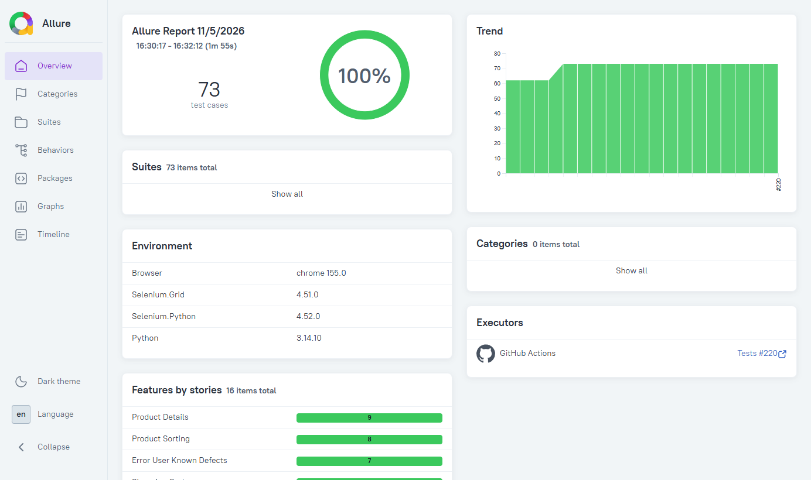

<!-- LTeX: language=pt-BR -->
<!-- translation-source: README.md sha256:bbb176cf2697c8a16a67346264053826babc28252dc005c27d4c6c397beb1330 -->
# UAT Automation Framework

[](https://github.com/brunoccalmeida/uat-automation-framework/actions/workflows/tests.yml)
[](https://github.com/brunoccalmeida/uat-automation-framework/actions/workflows/security.yml)
[](https://codecov.io/gh/brunoccalmeida/uat-automation-framework)
[](https://www.python.org/downloads/)
[](LICENSE)

**[English](README.md)** | **[Português (Brasil)]** | **[Español](README.es.md)**

Framework completo de automação UAT usando Python, Behave (BDD) e Selenium para testar a aplicação de e-commerce **Sauce Demo**.

## ⚡ Em Resumo

- **Testes:** 655 unitários · 96 de integração · 73 cenários E2E, construídos com TDD de duplo ciclo (cenários do Behave guiam os testes unitários do pytest)
- **Navegadores reais:** as suítes de integração e smoke rodam no Chrome e no Firefox no CI, em contêineres docker-selenium
- **Portões de qualidade:** o `master` só aceita PR com CI verde e `pip-audit` limpo; toda GitHub Action é fixada por SHA de commit
- **Relatório ao vivo:** Allure, republicado a cada merge no `master`: 📊 **[Ver o Relatório de Testes Mais Recente](https://brunoccalmeida.github.io/uat-automation-framework/)**
- **Feito com IA, mesmos portões:** construído com um agente de IA que não tem atalho no CI, no teste primeiro nem na revisão: [Como Este Projeto É Feito](#-como-este-projeto-é-feito)

[](https://brunoccalmeida.github.io/uat-automation-framework/)

## 📑 Índice

- [Objetivo](#-objetivo)
- [Arquitetura](#️-arquitetura)
- [Começando](#-começando)
- [Estratégia de Testes](#-estratégia-de-testes)
- [Stack Tecnológica](#️-stack-tecnológica)
- [CI/CD](#-cicd)
- [Como Este Projeto É Feito](#-como-este-projeto-é-feito)
- [Histórico do Projeto](#-histórico-do-projeto)
- [Contribuindo](#-contribuindo)
- [Licença](#-licença)

## 🎯 Objetivo

Este framework demonstra práticas profissionais de automação UAT para aplicações web, com:
- **Aplicação-alvo**: [Sauce Demo](https://www.saucedemo.com) - demo de e-commerce estável da Sauce Labs
- Behavior-Driven Development (BDD) com Behave
- Padrão de projeto Page Object Model
- Relatórios completos com Allure
- Usuários de teste pré-configurados (sem gestão de credenciais)

### Usuários de Teste

O Sauce Demo oferece usuários de teste pré-configurados (senha `secret_sauce` para todos):

- `standard_user` - Usuário normal, sem problemas
- `locked_out_user` - Usuário bloqueado
- `problem_user` - Usuário com falhas visuais
- `performance_glitch_user` - Usuário com problemas de desempenho
- `error_user` - Usuário que encontra erros
- `visual_user` - Usuário com variações para teste visual

**Segurança**: Nenhuma credencial precisa ser armazenada - os usuários são fornecidos pela própria aplicação de demonstração.

## 🏗️ Arquitetura

```
uat-automation-framework/
├── core/              # Núcleo do framework (config, drivers, utilitários)
├── pages/             # Page Object Models
├── features/          # Arquivos feature do BDD e step definitions
├── tests/             # Testes unitários dos componentes do framework
└── reports/           # Relatórios de execução (no .gitignore)
```

### Paradigma de Design: Abordagem Híbrida Pragmática

Este framework usa uma **abordagem híbrida de programação OO/funcional**, escolhendo o paradigma certo para cada componente:

**Programação Orientada a Objetos (60-70%)**
- **Page Objects**: Encapsulam o estado e as interações da página (encaixe natural para automação de UI)
- **Driver Manager**: Gerencia o ciclo de vida e o estado do WebDriver
- **Classes Base**: Funcionalidade compartilhada por herança onde faz sentido

**Programação Funcional (30-40%)**
- **Utilitários e Helpers**: Funções puras para transformação e geração de dados
- **Carregamento de Configuração**: Operações sem estado
- **Step Definitions**: Os steps do Behave são naturalmente funcionais

**Justificativa:**
- **Pragmatismo acima de pureza**: OO onde os padrões do Selenium/Page Object se encaixam naturalmente
- **Testabilidade**: Funções puras para a lógica de negócio tornam o teste unitário direto
- **Padrões da indústria**: O Page Object Model é esperado em automação de testes profissional
- **Manutenibilidade**: Padrões conhecidos reduzem a carga cognitiva de quem colabora
- **Zen of Python**: "Practicality beats purity" - escolher o que funciona melhor em cada caso

## 🚀 Começando

### Pré-requisitos

- Python 3.14+
- Poetry (gestão de dependências)
- Navegador Chrome ou Firefox (drivers gerenciados automaticamente pelo Selenium Manager)
- Docker (opcional): roda os testes no mesmo build de navegador do CI (veja [Mesmo navegador do CI](#mesmo-navegador-do-ci-selenium-grid-no-docker))

### Instalação

```bash
# Instalar as dependências
poetry install

# Instalar os hooks de pre-commit (configuração única)
poetry run pre-commit install
```


**Hooks de Pre-commit e Configuração de Lint:**
Os hooks do `.pre-commit-config.yaml` são o portão de lint: o job `lint` do CI roda os mesmos hooks (`pre-commit run --all-files`), sem pastas excluídas e sem falhas ignoradas (`tests/test_lint_gate.py`). Os linters rodam pelo Poetry, então as versões vêm do `poetry.lock`.

- ✅ **Black**: Formatação de código (88 colunas)
- ✅ **Ruff**: Regras de estilo e de erro (`E`, `W`, `F` do flake8), ordem dos imports (`I`) e as regras do Pylint que ele implementa (`PL`), configuradas em `[tool.ruff.lint]` (`pyproject.toml`)
- ✅ **Pylint**: Checagens que o Ruff não tem, como inferência e código duplicado (`[tool.pylint.*]` no `pyproject.toml`; cada checagem desligada tem o motivo ao lado, e nenhuma roda nos dois linters)
- ✅ **Pyright**: Checagem estática de tipos (`[tool.pyright]` no `pyproject.toml`; o editor roda o mesmo verificador)
- ✅ **Segurança**: Detecta chaves privadas e conflitos de merge
- ✅ **Qualidade**: Espaços no fim da linha, validação de YAML, métricas dos READMEs e suas traduções

Os hooks rodam automaticamente no `git commit`. Para rodar todos manualmente: `pre-commit run --all-files`

### Executando os Testes

**Testes BDD/E2E (Behave):**
```bash
# Executar todos os testes E2E (headless por padrão)
poetry run behave

# Executar uma feature específica
poetry run behave features/smoke.feature
poetry run behave features/login.feature

# Executar com o navegador visível (útil para depurar)
poetry run behave -Dheadless=false

# Executar com Firefox (Chrome é o padrão)
poetry run behave -Dbrowser=firefox

# Executar o Firefox em modo visível
poetry run behave -Dbrowser=firefox -Dheadless=false

# Executar em modo headless via variável de ambiente (útil em CI/CD)
$env:HEADLESS="true"; poetry run behave  # PowerShell
export HEADLESS=true && poetry run behave  # Bash

# Trocar o navegador via variável de ambiente
$env:BROWSER="firefox"; poetry run behave  # PowerShell
export BROWSER=firefox && poetry run behave  # Bash

# Executar com relatório Allure
poetry run behave -f allure_behave.formatter:AllureFormatter -o reports/allure-results

# Gerar e abrir o relatório Allure
allure serve reports/allure-results
```

**Executando Testes por Tags:**

O framework usa um sistema hierárquico de tags para filtrar os testes com precisão:

```bash
# Por camada de teste
poetry run behave --tags=@e2e              # Todos os testes E2E (padrão)

# Por tipo de teste
poetry run behave --tags=@smoke            # Só os smoke tests críticos
poetry run behave --tags=@functional       # Cenários de caminho feliz
poetry run behave --tags=@negative         # Casos negativos/de borda
poetry run behave --tags=@user_journey     # Fluxos completos de usuário

# Por domínio/feature
poetry run behave --tags=@login            # Todos os testes de login (funcionais + negativos)
poetry run behave --tags=@cart             # Todos os testes de carrinho
poetry run behave --tags=@checkout         # Todos os testes de checkout
poetry run behave --tags=@sorting          # Todos os testes de ordenação
poetry run behave --tags=@product_details  # Todos os testes de detalhes do produto

# Por prioridade/casos especiais
poetry run behave --tags=@critical         # Jornadas críticas de usuário
poetry run behave --tags=@edgecase         # Bugs conhecidos/casos de borda
poetry run behave --tags=@problem_user     # Cenários do problem_user
poetry run behave --tags=@error_user       # Defeitos conhecidos do error_user

# Combinar tags (lógica E)
poetry run behave --tags=@cart --tags=@negative    # Só os testes negativos de carrinho
poetry run behave --tags=@functional --tags=@cart  # Só os testes funcionais de carrinho

# Excluir tags (lógica NÃO)
poetry run behave --tags=~@edgecase        # Tudo, menos os casos de borda
poetry run behave --tags=@e2e --tags=~@smoke  # E2E sem os smoke tests
```

**Hierarquia de Tags:**
- **Camada**: `@e2e` (todas as features usam)
- **Tipo**: `@functional` | `@negative` | `@user_journey` | `@smoke` | `@edgecase`
- **Domínio**: `@login` | `@cart` | `@checkout` | `@sorting` | `@product_details`
- **Prioridade**: `@critical` | `@problem_user` | `@error_user`

**Testes Cross-Browser:**

O framework suporta os navegadores Chrome e Firefox. Use as flags `-D` para sobrescrever a configuração padrão:

```bash
# Smoke tests com Firefox (headless)
poetry run behave --tags=@smoke -Dbrowser=firefox -Dheadless=true

# Smoke tests com Firefox (navegador visível)
poetry run behave --tags=@smoke -Dbrowser=firefox -Dheadless=false

# Todos os testes com Chrome (padrão)
poetry run behave -Dbrowser=chrome

# Sobrescrever vários valores de configuração
poetry run behave -Dbrowser=firefox -Dheadless=false -Dtimeout=15
```

**Navegadores suportados:**
- `chrome` (padrão) - Google Chrome com ChromeDriver
- `firefox` - Mozilla Firefox com GeckoDriver

**Nota**: O Selenium Manager baixa e gerencia os drivers dos navegadores automaticamente - não é preciso instalar nada à mão.


**Testes Unitários (Pytest):**
```bash
# Executar todos os testes unitários (execução paralela)
poetry run pytest tests/ -n auto -v

# Executar com relatório de cobertura (paralelo)
poetry run pytest tests/ -n auto --cov=core --cov=pages --cov-report=term-missing

# Executar um módulo de teste específico
poetry run pytest tests/test_login_page.py -v

# Executar sequencialmente (para depurar)
poetry run pytest tests/ -n 0 -v

# Executar todos os testes (unit + integração + E2E)
poetry run pytest tests/ -n auto && poetry run pytest tests/integration/ -n auto && poetry run behave
```

**Testes de Integração (Pytest + Navegador Real):**
```bash
# Executar todos os testes de integração (execução paralela)
poetry run pytest tests/integration/ -n auto -v

# Executar um teste de integração específico
poetry run pytest tests/integration/test_login_page_integration.py -v

# Executar em modo headless (paralelo)
$env:HEADLESS="true"; poetry run pytest tests/integration/ -n auto -v  # PowerShell
export HEADLESS=true && poetry run pytest tests/integration/ -n auto -v  # Bash
```

**Execução Paralela:**

Este framework suporta execução paralela de testes com `pytest-xdist`:
- **Desempenho**: 88% mais rápido (188 testes em ~37s contra ~305s)
- **Segurança**: Todos os testes são independentes (fixtures com escopo de função)
- **Automático**: Use `-n auto` para detectar os núcleos de CPU automaticamente
- **Depuração**: Use `-n 0` para desligar a paralelização

Veja [docs/PARALLEL_TESTING.md](docs/PARALLEL_TESTING.md) para a documentação detalhada.

**Configuração do Modo Headless:**

O framework roda em **modo headless por padrão** (boa prática: mais rápido, usa menos recursos, consistente com o CI/CD).

Prioridade da configuração:
1. **Parâmetro de CLI** (maior): `-Dheadless=true/false`
2. **Variável de Ambiente**: `HEADLESS=true/false`
3. **Arquivo de Configuração** (menor): `config.yaml` (padrão: `true`)

Use `-Dheadless=false` para depurar com o navegador visível.

Veja [CONFIGURATION.md](CONFIGURATION.md) para as opções de configuração detalhadas.

### Mesmo navegador do CI (Selenium Grid no Docker)

O CI roda todo teste de navegador contra o Selenium Grid definido no [compose.yaml](compose.yaml) (imagens oficiais do docker-selenium, fixadas por tag e digest). Rodar localmente contra o mesmo container dá o mesmo build de navegador do CI (paridade dev/prod do 12-factor), qualquer que seja o seu sistema operacional:

```bash
# Subir o Grid; o --wait só retorna quando o health check passa (Grid pronto)
SE_NODE_MAX_SESSIONS=$(nproc) docker compose up --wait chrome    # bash
$env:SE_NODE_MAX_SESSIONS=$env:NUMBER_OF_PROCESSORS; docker compose up --wait chrome  # PowerShell

# Apontar os testes para ele (no Behave, -Dremote_url=... também funciona)
export SELENIUM_REMOTE_URL=http://localhost:4444          # bash
$env:SELENIUM_REMOTE_URL="http://localhost:4444"          # PowerShell
poetry run pytest tests/integration/ -n auto
poetry run behave

# O Grid do Firefox escuta na porta 4445 (-Dremote_url vence a variável de ambiente)
docker compose up --wait firefox
poetry run behave -Dbrowser=firefox -Dremote_url=http://localhost:4445

docker compose down
```

`SE_NODE_MAX_SESSIONS` dá ao Grid uma sessão por CPU, casando com os workers do `pytest -n auto` (o padrão da imagem é 1). Sem `SELENIUM_REMOTE_URL`, os testes usam um navegador local.

## 🔄 CI/CD

O projeto usa **GitHub Actions** para integração contínua:

- ✅ **Testes automatizados** em todo push e pull request
- ✅ **Python 3.14**, a versão estável mais recente
- ✅ Execução com **navegador headless** no ambiente de CI
- ✅ **Navegador no docker-selenium**: os jobs de navegador sobem o Selenium Grid do `compose.yaml`, a mesma imagem fixada da execução local
- ✅ **Integração em vários navegadores**: os testes de integração dos Page Objects rodam no Chrome e no Firefox, em jobs paralelos
- ✅ Checagens de **qualidade de código** (Black, Ruff, Pylint, Pyright)
- ✅ **Artefatos de teste** enviados para revisão
- ✅ **Relatórios Allure** publicados no GitHub Pages com histórico
- ✅ **Auditoria de vulnerabilidades** com `pip-audit` (PyPI/OSV) em todo pull request e diariamente, como segunda fonte ao lado do Dependabot (GitHub Advisory Database)

**Ver os Relatórios de Teste:** [https://brunoccalmeida.github.io/uat-automation-framework/](https://brunoccalmeida.github.io/uat-automation-framework/)

Os relatórios incluem:
- Tendências e histórico de execução (últimas 20 execuções)
- Resultados detalhados com screenshots nas falhas
- Métricas de duração e acompanhamento de desempenho
- Organização por features e cenários
- Ambiente e executor: navegador, versões do Selenium Grid, do Python e do Selenium, com link para a execução do CI

Veja [.github/workflows/tests.yml](.github/workflows/tests.yml) e [.github/workflows/security.yml](.github/workflows/security.yml) para a configuração do pipeline.

**Auditando as dependências localmente** (mesmo comando e mesma versão travada do CI):

```bash
poetry sync --no-root            # deixa o ambiente idêntico ao poetry.lock
poetry run pip-audit --strict    # falha com qualquer vulnerabilidade conhecida ou pacote não auditável
```

Qualquer vulnerabilidade conhecida reprova o check `pip-audit`. Para aceitar uma, adicione `--ignore-vuln <ID>` no `security.yml` com a justificativa e a issue que acompanha a remoção.

## 🤖 Como Este Projeto É Feito

Com IA, atrás dos mesmos portões de qualquer outra mudança. O trabalho é feito com um agente de IA (Claude Code; o GitHub Copilot lê as mesmas regras), e os commits dele levam o Claude como coautor (trailer `Co-Authored-By`). O agente não tem atalho:

- **Mesmos portões de CI:** o `master` só aceita PR com `ci-passed` e `pip-audit` verdes no commit da head; o ruleset não tem bypass, nem para o dono.
- **Teste primeiro:** todo teste é visto falhando antes do código que o faz passar; quando isso não foi observado, uma mutação (desfazer a correção e ver o teste falhar) confirma.
- **Revisão independente:** antes de cada PR, um agente revisor, só de leitura, confere o diff contra a issue do GitHub.
- **Um humano faz o merge:** o agente abre o PR; só o dono dispara o merge, porque o merge no `master` publica o relatório.
- **Regras como código:** as regras do agente moram no repositório ([.github/copilot-instructions.md](.github/copilot-instructions.md)), e regra sem exceção vira teste (por exemplo `tests/test_agent_rules.py`), não lembrete.

Notas de trabalho (handoff entre sessões, medições de gasto de tokens): [docs/ai-workflow/](docs/ai-workflow/).

## 🛠️ Stack Tecnológica

- **Python 3.14**: Linguagem principal
- **Selenium 4**: Automação de navegador
- **Behave**: Framework de testes BDD/E2E
- **Pytest**: Framework de testes unitários
- **Allure**: Relatórios de teste com histórico e tendências
- **Poetry**: Gestão de dependências
- **GitHub Actions**: Pipeline de CI/CD
- **GitHub Pages**: Hospedagem do relatório de testes ao vivo

## 🧪 Estratégia de Testes

Este framework implementa a arquitetura completa da **Pirâmide de Testes**, com três camadas distintas:

```
     Testes E2E (BDD)             ← Lentos, fluxos completos de usuário
      /-------------------\
     / Testes de Integração\      ← Médios, página + navegador
    /-----------------------\
   /    Testes Unitários     \    ← Rápidos, lógica de componente
  /---------------------------\
```

**Distribuição por Camada:**
- **Testes Unitários**: 655 testes (componentes do framework, 100% de cobertura dos Page Objects, proteções do CI)
- **Testes de Integração**: 96 testes (Page Objects + navegador real, incluindo a sincronização da navegação)
- **Testes E2E**: 73 cenários, 463 steps (jornadas completas de usuário)
- **Total**: 751 testes unitários/de integração + 73 cenários E2E

**Quando Usar Cada Camada:**
| Tipo de Teste | Propósito | Velocidade | Navegador | Exemplo |
|---------------|-----------|------------|-----------|---------|
| **Unitário** | Lógica de componente | Rápido | Mockado | "O `login()` chama os métodos corretos?" |
| **Integração** | Página + DOM real | Médio | Real | "Os campos de login existem e funcionam?" |
| **E2E** | Fluxos completos de usuário | Lento | Real | "O usuário consegue completar login→compra→checkout?" |

### Testes BDD/E2E (Behave)

| Feature | Fonte | Cenários | Steps | Status |
|---------|-------|----------|-------|--------|
| **Smoke Tests** | `features/smoke.feature` | 4 | 14 | ✅ Completo |
| **Login de Usuário** | `features/login.feature`, `features/login_negative.feature` | 9 | 42 | ✅ Completo |
| **Carrinho de Compras** | `features/cart.feature`, `features/cart_negative.feature` | 11 | 65 | ✅ Completo |
| **Checkout** | `features/checkout.feature`, `features/checkout_negative.feature` | 12 | 95 | ✅ Completo |
| **Ordenação de Produtos** | `features/product_sorting.feature`, `features/product_sorting_negative.feature`, `features/product_sorting_problem_user.feature` | 14 | 92 | ✅ Completo |
| **Jornada do Usuário** | `features/user_journey_purchase.feature`, `features/user_journey_variations.feature`, `features/problem_user_journey.feature` | 5 | 78 | ✅ Completo |
| **Error User (defeitos conhecidos)** | `features/error_user.feature` | 7 | 35 | ✅ Completo |
| **Detalhes do produto (com defeitos conhecidos)** | `features/product_details.feature`, `features/product_details_known_defects.feature` | 11 | 42 | ✅ Completo |
| **TOTAL** | | **73** | **463** | **100%** |

### Testes Unitários (Pytest)

| Módulo | Fonte | Testes | Cobertura | Status |
|--------|-------|--------|-----------|--------|
| **BasePage** | `tests/test_base_page.py` | 32 | 100% | ✅ Completo |
| **LoginPage** | `tests/test_login_page.py` | 16 | 100% | ✅ Completo |
| **CartPage** | `tests/test_cart_page.py` | 13 | 100% | ✅ Completo |
| **InventoryPage** | `tests/test_inventory_page.py` | 26 | 100% | ✅ Completo |
| **HeaderComponent** | `tests/test_header_component.py` | 18 | 100% | ✅ Completo |
| **ProductDetailsPage** | `tests/test_product_details_page.py` | 15 | 100% | ✅ Completo |
| **CheckoutStepOnePage** | `tests/test_checkout_step_one_page.py` | 15 | 100% | ✅ Completo |
| **CheckoutStepTwoPage** | `tests/test_checkout_step_two_page.py` | 16 | 100% | ✅ Completo |
| **CheckoutCompletePage** | `tests/test_checkout_complete_page.py` | 12 | 100% | ✅ Completo |
| **Config** | `tests/test_config.py` | 2 | 94% | ✅ Completo |
| **ConfigResolver** | `tests/test_config_resolver.py` | 48 | 100% | ✅ Completo |
| **DriverManager** | `tests/test_driver_manager.py` | 23 | 100% | ✅ Completo |
| **Setup do navegador dos testes (BROWSER, HEADLESS, Grid)** | `tests/test_driver_setup.py` | 3 | N/A | ✅ Completo |
| **Step definitions (lógica OU, senha da config, page objects locais)** | `tests/test_login_steps.py`, `tests/test_smoke_steps.py`, `tests/test_step_page_objects.py` | 20 | N/A | ✅ Completo |
| **Hooks do Behave (screenshot e URL da falha no Allure)** | `tests/test_environment.py` | 9 | N/A | ✅ Completo |
| **Smoke Tests** | `tests/test_smoke.py` | 4 | N/A | ✅ Completo |
| **Fixação das actions (CI)** | `tests/test_workflow_pinning.py` | 29 | N/A | ✅ Completo |
| **Portão do CI (check obrigatório)** | `tests/test_ci_gate.py` | 16 | N/A | ✅ Completo |
| **Selenium Grid no Docker (CI + compose)** | `tests/test_selenium_grid_ci.py` | 19 | N/A | ✅ Completo |
| **Upload para o Codecov (CI)** | `tests/test_codecov_upload.py` | 6 | N/A | ✅ Completo |
| **Ambiente e executor do Allure (CI)** | `tests/test_allure_metadata.py` | 8 | N/A | ✅ Completo |
| **Screenshot e HTML das falhas de integração (CI)** | `tests/test_failure_artifacts.py` | 10 | N/A | ✅ Completo |
| **Regras do agente (tamanho, sincronia, skills, subagente revisor, diagnósticos do editor, code intelligence)** | `tests/test_agent_rules.py` | 45 | N/A | ✅ Completo |
| **Links da documentação (todo caminho citado existe)** | `tests/test_doc_links.py` | 104 | N/A | ✅ Completo |
| **Hook de saída de testes do agente** | `tests/test_filter_test_output.py` | 21 | N/A | ✅ Completo |
| **Merge com checks verdes (`/ship-pr`: checks obrigatórios do ruleset, lista de permissão)** | `tests/test_merge_when_green.py` | 24 | N/A | ✅ Completo |
| **Portão de lint (pre-commit + CI + ordem de imports no editor, ruff no lugar do flake8, nenhuma regra em dois linters)** | `tests/test_lint_gate.py` | 25 | N/A | ✅ Completo |
| **Métricas dos READMEs (sincronia por linha pela coluna Fonte, traduções)** | `tests/test_validate_readme_metrics.py` | 51 | N/A | ✅ Completo |
| **Portão de encoding (pre-commit, `.gitattributes`)** | `tests/test_check_text_encoding.py` | 12 | N/A | ✅ Completo |
| **Chave do cache do venv (CI, versão exata do Python)** | `tests/test_venv_cache_key.py` | 4 | N/A | ✅ Completo |
| **Fonte da versão do Python (CI, `.python-version`)** | `tests/test_python_version_source.py` | 9 | N/A | ✅ Completo |
| **TOTAL** | | **655** | **100%** | **Completo** |

**Cobertura de Código:**
- **Total de statements:** 469
- **Cobertos:** 468 (99%)
- **Módulo Pages**: 100%
- **Módulo Core**: 99% (1 linha sem cobertura em `core/config.py`)

### Testes de Integração (Pytest + Navegador Real)

Os testes de integração validam os Page Objects com interações reais no navegador, preenchendo a lacuna entre os testes unitários (mockados) e os E2E (fluxos completos).

| Módulo | Fonte | Testes | Navegador | Status |
|--------|-------|--------|-----------|--------|
| **LoginPage** | `tests/integration/test_login_page_integration.py` | 11 | Chrome, Firefox | ✅ Completo |
| **InventoryPage** | `tests/integration/test_inventory_page_integration.py` | 7 | Chrome, Firefox | ✅ Completo |
| **HeaderComponent** | `tests/integration/test_header_component_integration.py` | 14 | Chrome, Firefox | ✅ Completo |
| **InventoryPage (ordenação)** | `tests/integration/test_inventory_sorting_integration.py` | 1 | Chrome, Firefox | ✅ Completo |
| **CartPage** | `tests/integration/test_cart_page_integration.py` | 10 | Chrome, Firefox | ✅ Completo |
| **ProductDetailsPage** | `tests/integration/test_product_details_integration.py` | 9 | Chrome, Firefox | ✅ Completo |
| **CheckoutStepOnePage** | `tests/integration/test_checkout_step_one_integration.py` | 16 | Chrome, Firefox | ✅ Completo |
| **CheckoutStepTwoPage** | `tests/integration/test_checkout_step_two_integration.py` | 14 | Chrome, Firefox | ✅ Completo |
| **Sincronização da navegação** | `tests/integration/test_navigation_integration.py` | 13 | Chrome, Firefox | ✅ Completo |
| **Sessão no Selenium Grid** | `tests/integration/test_remote_driver_integration.py` | 1 | Chrome, Firefox (Grid) | ✅ Completo |
| **TOTAL** | | **96** | **Real** | **Completo** |

**Diferenças em Relação aos Testes Unitários:**
- ✅ Selenium WebDriver real (não mockado)
- ✅ Validação de elementos reais do DOM
- ✅ Verificação real dos locators
- ✅ Teste das interações com o navegador
- ✅ Mais rápidos que os E2E (sem fluxos completos)
- ✅ Cobertura completa dos Page Objects (100%)

### Cenários de Teste

**Smoke Tests**
- ✅ A página inicial carrega e é exibida corretamente
- ✅ Elementos do formulário de login presentes e funcionando
- ✅ Autenticação de usuário válido
- ✅ Rejeição de credenciais inválidas

**Login de Usuário**
- ✅ Autenticação de usuário válido (standard_user)
- ✅ Rejeição de credenciais inválidas
- ✅ Detecção de usuário bloqueado (locked_out_user)
- ✅ Fluxo de logout bem-sucedido

**Carrinho de Compras**
- ✅ Adicionar um produto ao carrinho
- ✅ Adicionar vários produtos ao carrinho
- ✅ Ver o conteúdo do carrinho
- ✅ Remover um produto do carrinho
- ✅ Continuar comprando a partir do carrinho
- ✅ Carrinho mantido durante a navegação

**Checkout**
- ✅ Checkout completo com informações válidas
- ✅ Validação dos campos obrigatórios
- ✅ Resumo do pedido com detalhes de preço
- ✅ Cancelar o checkout e voltar ao carrinho
- ✅ Mensagem de confirmação do pedido
- ✅ Carrinho limpo após a compra

### Casos de Borda e Bugs Conhecidos

Alguns usuários do Sauce Demo (principalmente o `problem_user` e o `error_user`) foram projetados de propósito para apresentar bugs ou comportamentos fora do padrão, como falhas de ordenação, defeitos visuais ou etapas do checkout quebradas. Para manter a suíte clara e fácil de manter:

- **Cenários de usuário normal** ficam nos respectivos arquivos feature (ex.: `product_sorting.feature`).
- **Casos de borda e bugs conhecidos** (como o bug de ordenação do `problem_user`) ficam isolados em arquivos feature dedicados (ex.: [`product_sorting_problem_user.feature`](features/product_sorting_problem_user.feature), [`error_user.feature`](features/error_user.feature), [`product_details_known_defects.feature`](features/product_details_known_defects.feature)), com a tag `@edgecase`. Os cenários afirmam o defeito, então um cenário falha se o Sauce Demo mudar esse comportamento.

Por que essa separação?
- Mantém os requisitos de negócio e os testes de regressão limpos e focados
- Facilita rodar só os cenários de casos de borda: `poetry run behave --tags=edgecase`
- Simplifica a manutenção quando bugs são corrigidos ou novos casos de borda aparecem
- Melhora os relatórios e a comunicação com as partes interessadas

> Se o comportamento da aplicação mudar (ex.: um bug for corrigido), atualize ou remova o cenário de caso de borda correspondente.

## 📊 Relatórios de Teste

Os relatórios são gerados na pasta `reports/` e ficam fora do controle de versão automaticamente.

```bash
# Gerar o relatório Allure
poetry run behave -f allure_behave.formatter:AllureFormatter -o reports/allure-results
allure serve reports/allure-results
```

## 🎯 Roadmap

Melhorias futuras seguindo as melhores práticas da indústria:

- [x] **Execução Paralela** - pytest-xdist implementado (88% mais rápido)
- [x] **Testes Cross-browser** - Suporte a Chrome + Firefox com hierarquia CLI/ENV/config
- [x] **Matriz no CI** - Smoke tests rodam nos dois navegadores automaticamente
- [x] **Containerização com Docker** - Selenium Grid no docker-selenium, compartilhado entre execução local e CI
- [ ] **Testes de Regressão Visual** - Integração com Percy/Applitools
- [ ] **Testes de API** - Feedback mais rápido com testes no nível da API

## 🤝 Contribuindo

Este é um projeto de portfólio que demonstra práticas profissionais de automação UAT, seguindo:
- **Pirâmide de Testes**: Testes unitários → integração → E2E (separação correta das camadas)
- **TDD/BDD de fora para dentro**: Ciclo Red-Green-Refactor para todo código de produção
- **Page Object Model**: Separação clara entre a lógica de teste e as interações com a página
- **Esperas Explícitas**: Nada de `time.sleep()` - estratégias de espera adequadas do Selenium
- **Commits Atômicos**: Formato Conventional Commits para um histórico claro
- **Código Autodocumentado**: Docstrings completas e type hints
- **Integração com CI/CD**: Testes automatizados a cada push
- **Relatórios ao Vivo**: Hospedagem no GitHub Pages com relatórios Allure e histórico

## 📚 Histórico do Projeto

**Nota de Migração**: Este framework foi desenvolvido originalmente para o Parabank (demo bancário) e migrado com sucesso para o Sauce Demo em menos de 1 hora, o que comprova a robustez da arquitetura. Todos os padrões de design centrais (BDD, POM, boas práticas de Selenium) continuaram iguais, demonstrando a portabilidade real do framework.

## 📄 Licença

Licença MIT - veja o arquivo [LICENSE](LICENSE) para detalhes.

---

**Autor**: Bruno Almeida, QA Automation Engineer / SDET · [LinkedIn](https://www.linkedin.com/in/brunoccalmeida/)
**Propósito**: Portfólio profissional e demonstração de automação UAT
